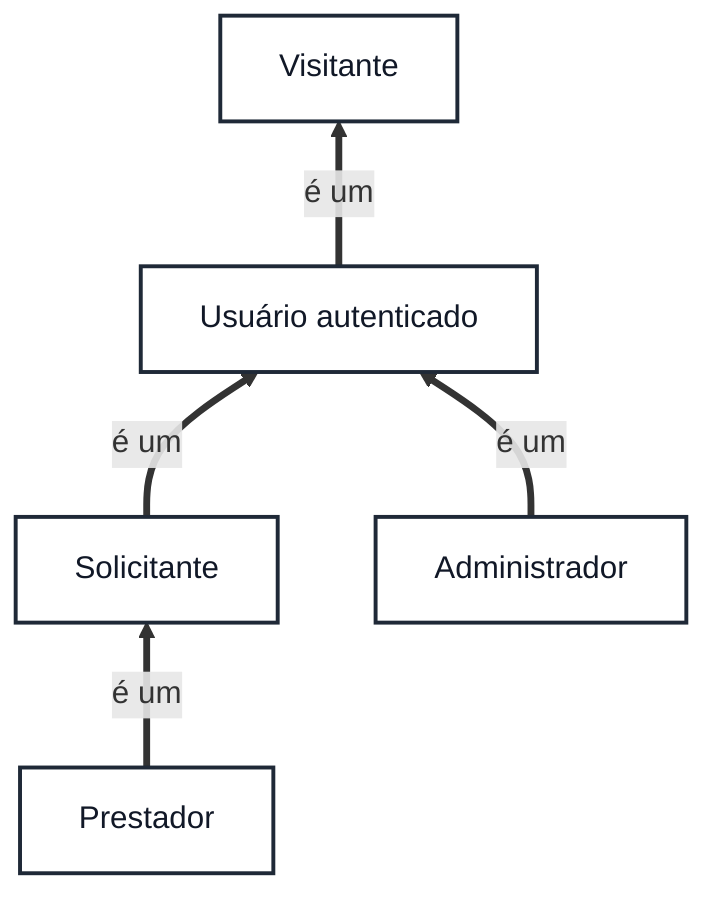
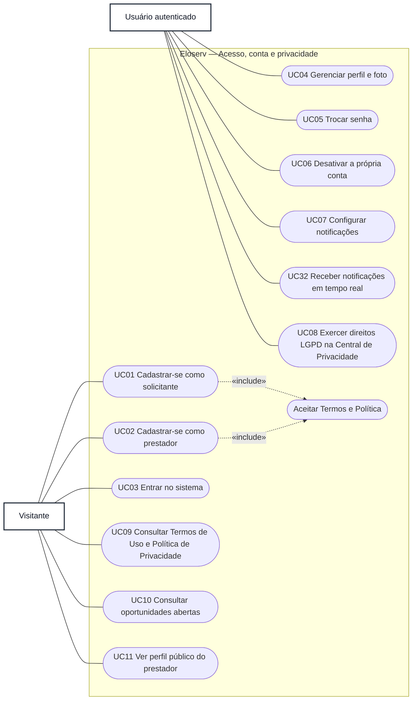
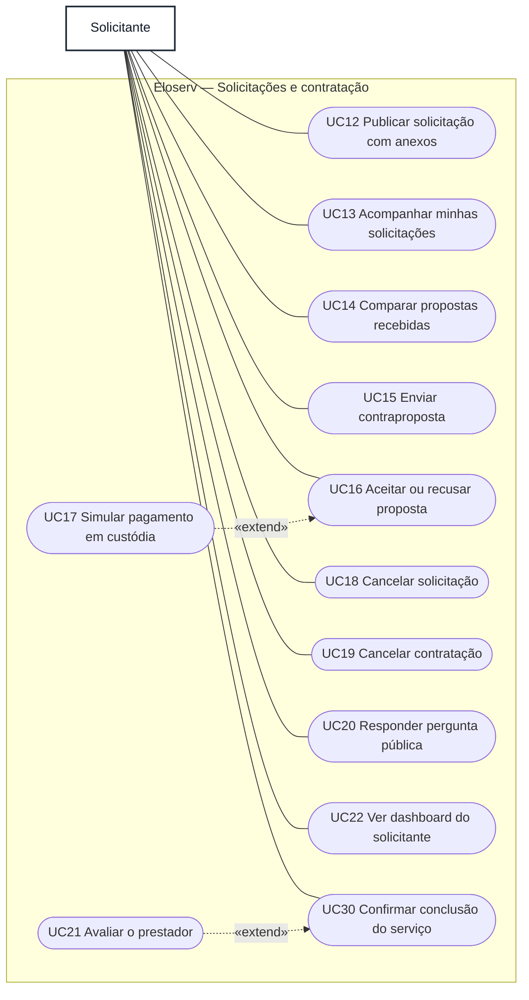
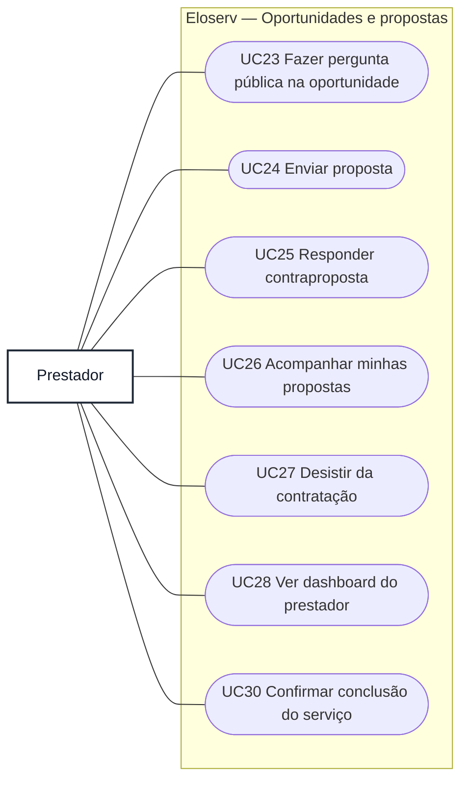
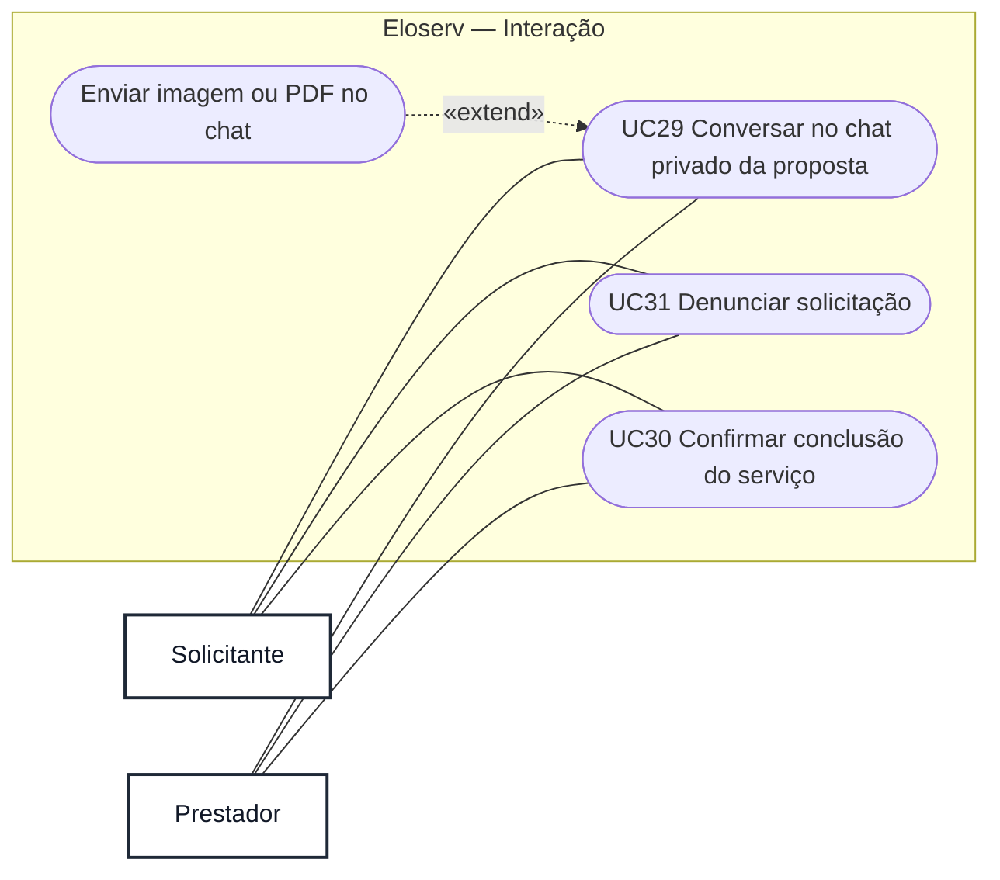
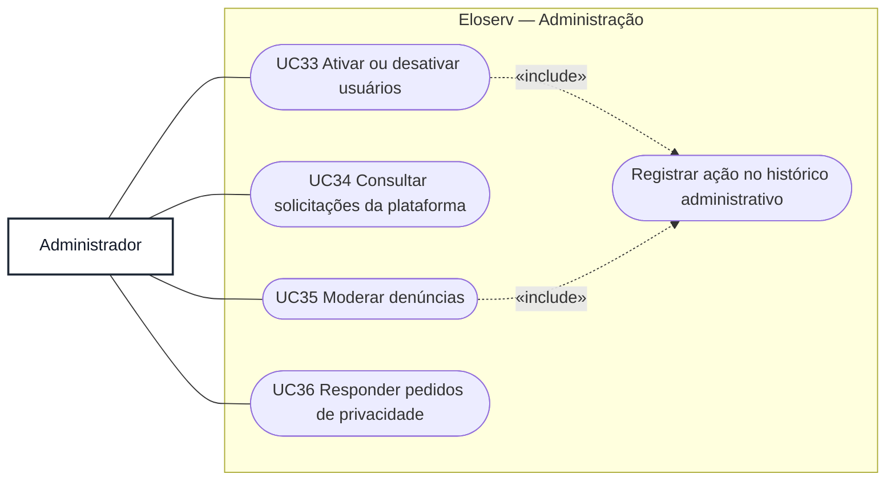

# Diagrama de Casos de Uso — Eloserv

Gerado a partir do código em 26/10/2026: rotas em `backend/src/routes`, regras de permissão nos controllers e services e telas em `frontend/src/app`.

O Mermaid não tem notação própria de casos de uso. Por isso, os diagramas usam fluxogramas com a seguinte convenção:

| Elemento UML | Representação aqui |
|---|---|
| Ator | retângulo com a classe `ator` |
| Caso de uso | forma arredondada `([ ... ])` |
| Fronteira do sistema | `subgraph` com o nome do módulo |
| Associação ator–caso de uso | linha contínua `---` |
| Generalização entre atores | seta grossa `==>` com o rótulo "é um" |
| `«include»` / `«extend»` | seta tracejada com o estereótipo no rótulo |

## 1. Atores e generalização

O prestador também pode publicar solicitações (US33), por isso herda os casos de uso do solicitante. Todo usuário autenticado também pode fazer o que o visitante faz.

## 2. Acesso, conta e privacidade

## 3. Solicitante

## 4. Prestador

## 5. Interação entre as partes

O chat e a denúncia só ficam disponíveis para quem participa da solicitação: o solicitante dono e os prestadores que enviaram proposta.

## 6. Administrador

## 7. Rastreabilidade: caso de uso → história → endpoint

Os caminhos são relativos a `/api/v1`.

| Caso de uso | Ator principal | História | Endpoint principal |
|---|---|---|---|
| UC01 Cadastrar-se como solicitante | Visitante | US01, US40 | `POST /auth/register/solicitante` |
| UC02 Cadastrar-se como prestador | Visitante | US02, US40 | `POST /auth/register/prestador` |
| UC03 Entrar no sistema | Visitante | US03, US22 | `POST /auth/login` |
| UC04 Gerenciar perfil e foto | Usuário autenticado | US04 | `GET/PUT /perfil`, `POST /perfil/foto` |
| UC05 Trocar senha | Usuário autenticado | US04 | `PUT /perfil/senha` |
| UC06 Desativar a própria conta | Usuário autenticado | US04 | `DELETE /perfil` |
| UC07 Configurar notificações | Usuário autenticado | US30 | `GET/PUT /perfil/preferencias-notificacao` |
| UC08 Exercer direitos LGPD | Usuário autenticado | US40 | `GET /privacidade/minha-central`, `POST /privacidade/solicitacoes` |
| UC09 Consultar Termos e Política | Visitante | US40 | `GET /legal/documentos` |
| UC10 Consultar oportunidades abertas | Visitante | US08, US36 | `GET /prestador/oportunidades` |
| UC11 Ver perfil público do prestador | Visitante | US19 | `GET /prestadores/{id}/perfil-publico` |
| UC12 Publicar solicitação com anexos | Solicitante | US05 | `POST /solicitacoes` |
| UC13 Acompanhar minhas solicitações | Solicitante | US06 | `GET /solicitacoes/minhas` |
| UC14 Comparar propostas recebidas | Solicitante | US11 | `GET /solicitacoes/minhas/{id}/propostas` |
| UC15 Enviar contraproposta | Solicitante | US34, US35 | `POST /solicitacoes/minhas/{id}/propostas/{propostaId}/renegociar` |
| UC16 Aceitar ou recusar proposta | Solicitante | US12 | `PATCH /solicitacoes/minhas/{id}/propostas/{propostaId}/status` |
| UC17 Simular pagamento em custódia | Solicitante | US13 | `POST /solicitacoes/{id}/custodia/simular` |
| UC18 Cancelar solicitação | Solicitante | US07 | `PATCH /solicitacoes/{id}/cancelar` |
| UC19 Cancelar contratação | Solicitante | US34 | `PATCH /solicitacoes/{id}/cancelar-contratacao` |
| UC20 Responder pergunta pública | Solicitante | US29 | `PATCH /solicitacoes/{id}/perguntas/{perguntaId}/responder` |
| UC21 Avaliar o prestador | Solicitante | US18 | `POST /solicitacoes/{id}/avaliar` |
| UC22 Ver dashboard do solicitante | Solicitante | US20 | `GET /dashboards/solicitante` |
| UC23 Fazer pergunta pública | Prestador | US29 | `POST /solicitacoes/{id}/perguntas` |
| UC24 Enviar proposta | Prestador | US10 | `POST /prestador/oportunidades/{id}/propostas` |
| UC25 Responder contraproposta | Prestador | US35 | `POST /prestador/oportunidades/{id}/propostas/{propostaId}/contraproposta/responder` |
| UC26 Acompanhar minhas propostas | Prestador | US28 | `GET /prestador/propostas` |
| UC27 Desistir da contratação | Prestador | US31 | `PATCH /prestador/oportunidades/{id}/desistir` |
| UC28 Ver dashboard do prestador | Prestador | US21 | `GET /dashboards/prestador` |
| UC29 Conversar no chat da proposta | Solicitante e prestador | US14, US15, US34 | `GET/POST /propostas/{propostaId}/mensagens` |
| UC30 Confirmar conclusão do serviço | Solicitante e prestador | US17 | `PATCH /solicitacoes/{id}/concluir` |
| UC31 Denunciar solicitação | Solicitante e prestador | US32 | `POST /solicitacoes/{id}/denunciar` |
| UC32 Receber notificações | Usuário autenticado | US16 | `GET /notificacoes` e evento Socket.io `nova-notificacao` |
| UC33 Ativar ou desativar usuários | Administrador | US27 | `PATCH /admin/usuarios/{id}/status` |
| UC34 Consultar solicitações | Administrador | US27 | `GET /admin/solicitacoes` |
| UC35 Moderar denúncias | Administrador | US27, US32 | `GET /admin/denuncias`, `PATCH /admin/denuncias/{id}/resolver` |
| UC36 Responder pedidos de privacidade | Administrador | US40 | `GET /admin/privacidade`, `PATCH /admin/privacidade/{id}/resposta` |

**Observações sobre o código atual:**

- No backend, as rotas de prestador (enviar proposta, perguntar e o dashboard de prestador) aceitam os perfis `PRESTADOR` e `ADMIN`. O diagrama mostra só o prestador porque as telas do administrador não oferecem essas ações.
- O UC17 aparece como `«extend»` do aceite (UC16) porque o pagamento é feito num passo separado, depois da contratação. Ele é **pré-condição** do UC30: desde 26/10/2026 (critério da US17), a conclusão só é aceita com o pagamento simulado retido em custódia. Veja a regra no [diagrama de sequência](sequencia-contratacao.md).
