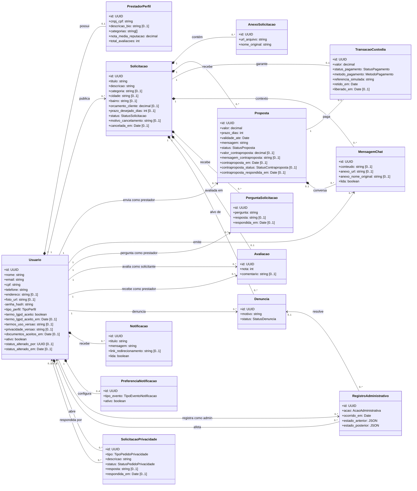
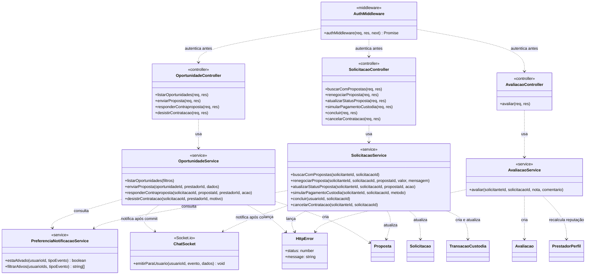

# Diagrama de Classes — Eloserv

Gerado a partir do código em 26/10/2026:

- classes de domínio: models Sequelize em `backend/src/models/*.ts`;
- associações: `backend/src/models/index.ts`;
- serviços: `backend/src/services` e `backend/src/controllers`.

Os campos `created_at` e `updated_at`, presentes em todas as classes exceto `RegistroAdministrativo`, foram omitidos para deixar o diagrama legível.

## 1. Modelo de domínio

**Como ler:**

- `*--` (losango cheio) é **composição**: a parte não existe sem o todo, e o banco apaga em cascata (`ON DELETE CASCADE`). Por exemplo, apagar uma solicitação apaga seus anexos, propostas e mensagens.
- `-->` é **associação dirigida**: a classe de origem é referenciada pela chave estrangeira do destino.
- `PrestadorPerfil` só existe para usuários com `tipo_perfil = PRESTADOR`. A plataforma é bilateral: o mesmo `Usuario` pode publicar solicitações e, se for prestador, também enviar propostas para solicitações de outras pessoas (US33).
- `PreferenciaNotificacao` tem no máximo 4 registros por usuário, um por tipo de evento (índice único `usuario_id + tipo_evento`).
- `MensagemChat.proposta_id` é opcional por causa das conversas antigas, feitas por solicitação. Desde a US34, cada conversa pertence a uma proposta.

## 2. Enumerações

```mermaid
classDiagram
    direction LR

    class TipoPerfil {
        <<enumeration>>
        SOLICITANTE
        PRESTADOR
        ADMIN
    }
    class StatusSolicitacao {
        <<enumeration>>
        ABERTA
        EM_NEGOCIACAO
        CONTRATADA
        CONCLUIDA
        CANCELADA
    }
    class StatusProposta {
        <<enumeration>>
        ENVIADA
        EM_ANALISE
        ACEITA
        RECUSADA
    }
    class StatusContraproposta {
        <<enumeration>>
        PENDENTE
        ACEITA
        RECUSADA
    }
    class StatusPagamento {
        <<enumeration>>
        RETIDO
        LIBERADO
        REEMBOLSADO
    }
    class MetodoPagamento {
        <<enumeration>>
        CARTAO_TESTE
        PIX_TESTE
    }
    class StatusDenuncia {
        <<enumeration>>
        PENDENTE
        RESOLVIDA
    }
    class TipoEventoNotificacao {
        <<enumeration>>
        NOVA_PROPOSTA
        PROPOSTA_ACEITA_RECUSADA
        NOVA_MENSAGEM_CHAT
        SOLICITACAO_CANCELADA
    }
    class AcaoAdministrativa {
        <<enumeration>>
        ATIVAR_USUARIO
        DESATIVAR_USUARIO
        RESOLVER_DENUNCIA
    }
    class TipoPedidoPrivacidade {
        <<enumeration>>
        ACESSO
        CORRECAO
        EXCLUSAO
        INFORMACAO
        REVOGACAO
    }
    class StatusPedidoPrivacidade {
        <<enumeration>>
        PENDENTE
        RESPONDIDA
    }
```

## 3. Camadas do backend no fluxo de contratação

O backend segue a divisão `Routes → Middlewares → Controllers → Services → Models`. O diagrama abaixo mostra só as classes que participam da contratação. Os controllers validam a entrada HTTP e convertem erros (`HttpError`) em respostas; os services concentram as regras de negócio e as transações; os models fazem o mapeamento objeto-relacional com o Sequelize.

Os nomes dos métodos são os que existem nos arquivos. Os controllers estão resumidos às ações da contratação.
