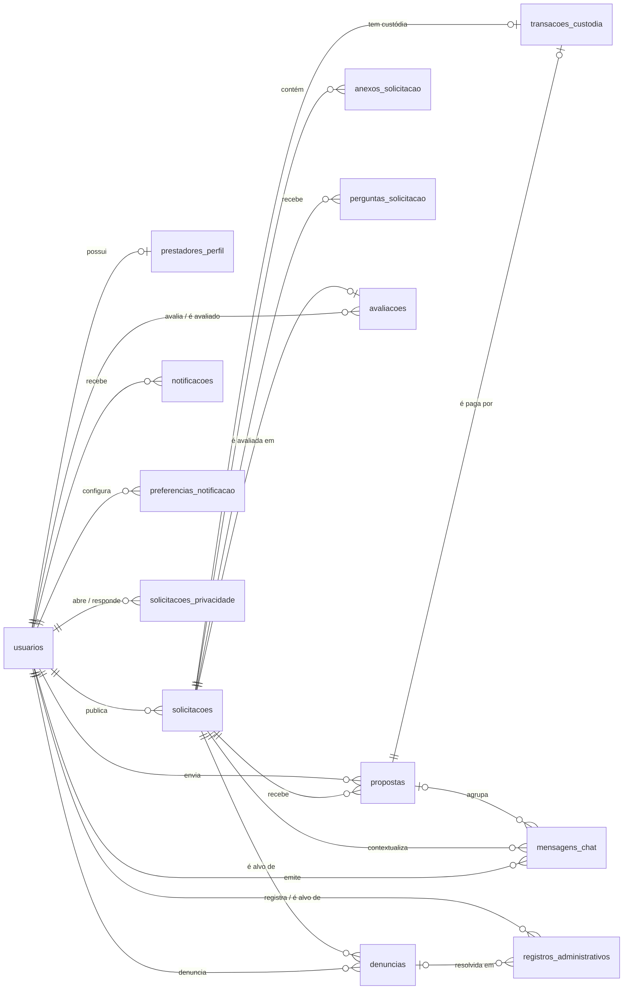

# Modelo Entidade-Relacionamento (MER) — Eloserv

Gerado em 26/10/2026 a partir do esquema real do banco `tcc_eloserv` (MySQL 8.0), lido em `information_schema` depois de aplicadas as 24 migrations de `backend/src/migrations`. A tabela técnica `SequelizeMeta`, que só registra as migrations aplicadas, foi omitida.

- **Tipos:** os mostrados são os físicos do MySQL.
- **Identificadores:** todas as chaves primárias são UUID armazenados como `char(36)`.
- **Datas de registro:** `created_at` e `updated_at` (`datetime`) existem em todas as tabelas, exceto `registros_administrativos`, e foram omitidos.
- **Siglas:** `PK` = chave primária, `FK` = chave estrangeira, `UK` = valor único. O comentário "opcional" marca as colunas que aceitam `NULL`.

## 1. Visão resumida

Só entidades e relacionamentos, para caber numa página da monografia. Os atributos estão no diagrama completo da seção 2.

## 2. Diagrama completo

```mermaid
erDiagram
    usuarios {
        char(36) id PK
        varchar(150) nome
        varchar(150) email UK
        varchar(14) cpf UK
        varchar(20) telefone
        varchar(255) endereco "opcional"
        varchar(500) foto_url "opcional"
        varchar(255) senha_hash "hash bcrypt"
        enum tipo_perfil "SOLICITANTE, PRESTADOR, ADMIN"
        tinyint(1) termo_lgpd_aceito
        datetime termo_lgpd_aceito_em "opcional"
        varchar(40) termos_uso_versao "opcional"
        varchar(40) privacidade_versao "opcional"
        datetime documentos_aceitos_em "opcional"
        tinyint(1) ativo
        char(36) status_alterado_por FK "opcional"
        datetime status_alterado_em "opcional"
    }

    prestadores_perfil {
        char(36) id PK
        char(36) usuario_id FK
        varchar(20) cnpj_cpf
        text descricao_bio "opcional"
        json categorias
        decimal(3_2) nota_media_reputacao
        int total_avaliacoes
    }

    solicitacoes {
        char(36) id PK
        char(36) solicitante_id FK
        varchar(180) titulo
        text descricao
        varchar(100) categoria "opcional"
        varchar(100) cidade "opcional"
        varchar(100) bairro "opcional"
        decimal(10_2) orcamento_cliente "opcional"
        int prazo_desejado_dias "opcional"
        enum status "ABERTA, EM_NEGOCIACAO, CONTRATADA, CONCLUIDA, CANCELADA"
        text motivo_cancelamento "opcional"
        datetime cancelada_em "opcional"
    }

    anexos_solicitacao {
        char(36) id PK
        char(36) solicitacao_id FK
        varchar(500) url_arquivo
        varchar(255) nome_original
    }

    propostas {
        char(36) id PK
        char(36) solicitacao_id FK
        char(36) prestador_id FK
        decimal(10_2) valor
        int prazo_dias
        datetime validade_ate
        text mensagem
        enum status "ENVIADA, EM_ANALISE, ACEITA, RECUSADA"
        decimal(10_2) valor_contraproposta "opcional"
        text mensagem_contraproposta "opcional"
        datetime contraproposta_em "opcional"
        enum contraproposta_status "PENDENTE, ACEITA, RECUSADA, opcional"
        datetime contraproposta_respondida_em "opcional"
    }

    transacoes_custodia {
        char(36) id PK
        char(36) solicitacao_id FK,UK
        char(36) proposta_id FK,UK
        decimal(10_2) valor
        enum status_pagamento "RETIDO, LIBERADO, REEMBOLSADO"
        enum metodo_pagamento "CARTAO_TESTE, PIX_TESTE"
        varchar(120) referencia_simulada UK
        datetime retido_em
        datetime liberado_em "opcional"
    }

    mensagens_chat {
        char(36) id PK
        char(36) solicitacao_id FK
        char(36) proposta_id FK "opcional"
        char(36) emissor_id FK
        text conteudo "opcional"
        varchar(500) anexo_url "opcional"
        varchar(255) anexo_nome_original "opcional"
        tinyint(1) lida
    }

    perguntas_solicitacao {
        char(36) id PK
        char(36) solicitacao_id FK
        char(36) prestador_id FK
        text pergunta
        text resposta "opcional"
        datetime respondida_em "opcional"
    }

    avaliacoes {
        char(36) id PK
        char(36) solicitacao_id FK,UK
        char(36) solicitante_id FK
        char(36) prestador_id FK
        int nota "1 a 5"
        text comentario "opcional"
    }

    denuncias {
        char(36) id PK
        char(36) solicitacao_id FK
        char(36) denunciante_id FK
        text motivo
        enum status "PENDENTE, RESOLVIDA"
    }

    notificacoes {
        char(36) id PK
        char(36) usuario_id FK
        varchar(180) titulo
        text mensagem
        varchar(255) link_redirecionamento "opcional"
        tinyint(1) lida
    }

    preferencias_notificacao {
        char(36) id PK
        char(36) usuario_id FK "UK com tipo_evento"
        enum tipo_evento "NOVA_PROPOSTA, PROPOSTA_ACEITA_RECUSADA, NOVA_MENSAGEM_CHAT, SOLICITACAO_CANCELADA"
        tinyint(1) ativo
    }

    registros_administrativos {
        char(36) id PK
        char(36) admin_id FK
        char(36) usuario_id FK "opcional"
        char(36) denuncia_id FK "opcional"
        enum acao "ATIVAR_USUARIO, DESATIVAR_USUARIO, RESOLVER_DENUNCIA"
        datetime ocorrido_em
        json estado_anterior
        json estado_posterior
    }

    solicitacoes_privacidade {
        char(36) id PK
        char(36) usuario_id FK
        enum tipo "ACESSO, CORRECAO, EXCLUSAO, INFORMACAO, REVOGACAO"
        text descricao
        enum status "PENDENTE, RESPONDIDA"
        text resposta "opcional"
        char(36) respondida_por FK "opcional"
        datetime respondida_em "opcional"
    }

    usuarios ||--o| prestadores_perfil : "possui"
    usuarios ||--o{ solicitacoes : "publica"
    usuarios ||--o{ propostas : "envia"
    usuarios ||--o{ mensagens_chat : "emite"
    usuarios ||--o{ perguntas_solicitacao : "pergunta"
    usuarios ||--o{ avaliacoes : "avalia"
    usuarios ||--o{ avaliacoes : "é avaliado"
    usuarios ||--o{ denuncias : "denuncia"
    usuarios ||--o{ notificacoes : "recebe"
    usuarios ||--o{ preferencias_notificacao : "configura"
    usuarios ||--o{ registros_administrativos : "registra"
    usuarios |o--o{ registros_administrativos : "é alvo de"
    usuarios ||--o{ solicitacoes_privacidade : "abre"
    usuarios |o--o{ solicitacoes_privacidade : "responde"
    usuarios |o--o{ usuarios : "altera status de"
    solicitacoes ||--o{ anexos_solicitacao : "contém"
    solicitacoes ||--o{ propostas : "recebe"
    solicitacoes ||--o| transacoes_custodia : "tem custódia"
    propostas ||--o| transacoes_custodia : "é paga por"
    solicitacoes ||--o{ mensagens_chat : "contextualiza"
    propostas |o--o{ mensagens_chat : "agrupa"
    solicitacoes ||--o{ perguntas_solicitacao : "recebe"
    solicitacoes ||--o| avaliacoes : "é avaliada em"
    solicitacoes ||--o{ denuncias : "é alvo de"
    denuncias |o--o{ registros_administrativos : "resolvida em"
```

Notação de cardinalidade (pé de galinha): `||` exatamente um, `|o` zero ou um, `o{` zero ou muitos.

No tipo `decimal`, o Mermaid não aceita vírgula. Por isso, `decimal(10_2)` representa `decimal(10,2)`.

## 3. Chaves estrangeiras e regra de exclusão

Lidas de `information_schema.REFERENTIAL_CONSTRAINTS`.

| Tabela | Coluna | Referencia | `ON DELETE` |
|---|---|---|---|
| prestadores_perfil | usuario_id | usuarios | CASCADE |
| solicitacoes | solicitante_id | usuarios | CASCADE |
| anexos_solicitacao | solicitacao_id | solicitacoes | CASCADE |
| propostas | solicitacao_id | solicitacoes | CASCADE |
| propostas | prestador_id | usuarios | CASCADE |
| transacoes_custodia | solicitacao_id | solicitacoes | CASCADE |
| transacoes_custodia | proposta_id | propostas | CASCADE |
| mensagens_chat | solicitacao_id | solicitacoes | CASCADE |
| mensagens_chat | proposta_id | propostas | CASCADE |
| mensagens_chat | emissor_id | usuarios | NO ACTION |
| perguntas_solicitacao | solicitacao_id | solicitacoes | CASCADE |
| perguntas_solicitacao | prestador_id | usuarios | NO ACTION |
| avaliacoes | solicitacao_id | solicitacoes | CASCADE |
| avaliacoes | solicitante_id | usuarios | NO ACTION |
| avaliacoes | prestador_id | usuarios | NO ACTION |
| denuncias | solicitacao_id | solicitacoes | CASCADE |
| denuncias | denunciante_id | usuarios | NO ACTION |
| notificacoes | usuario_id | usuarios | CASCADE |
| preferencias_notificacao | usuario_id | usuarios | CASCADE |
| registros_administrativos | admin_id | usuarios | RESTRICT |
| registros_administrativos | usuario_id | usuarios | RESTRICT |
| registros_administrativos | denuncia_id | denuncias | RESTRICT |
| solicitacoes_privacidade | usuario_id | usuarios | CASCADE |
| solicitacoes_privacidade | respondida_por | usuarios | NO ACTION |
| usuarios | status_alterado_por | usuarios | NO ACTION |

São 25 chaves estrangeiras.

- **RESTRICT no histórico administrativo:** impede apagar um usuário ou uma denúncia que já tenha ação registrada, preservando a trilha de auditoria (US27).
- **Desativação lógica:** a conta é desativada com `ativo = false` e nunca é apagada fisicamente pela aplicação (US04). Por isso as exclusões em cascata vindas de `usuarios` não são disparadas no uso normal.

## 4. Restrições de unicidade

| Tabela | Colunas | Regra de negócio garantida |
|---|---|---|
| usuarios | email | Um cadastro por e-mail (US01) |
| usuarios | cpf | Um cadastro por CPF (US01) |
| transacoes_custodia | solicitacao_id | Uma custódia por solicitação; após reembolso, o mesmo registro é reutilizado na recontratação (US13, US31) |
| transacoes_custodia | proposta_id | Uma custódia por proposta |
| transacoes_custodia | referencia_simulada | Comprovante simulado único |
| avaliacoes | solicitacao_id | Uma avaliação por serviço (US18) |
| preferencias_notificacao | usuario_id + tipo_evento | Uma preferência por tipo de evento (US30) |

**Regras garantidas só pela aplicação**, com bloqueio de linha (`SELECT ... FOR UPDATE`) dentro de uma transação e sem índice único no banco:

- uma proposta por prestador em cada solicitação (US10);
- no máximo uma proposta `ACEITA` por solicitação (US12);
- um único `prestadores_perfil` por usuário, cuja coluna `usuario_id` tem índice comum, não único.
