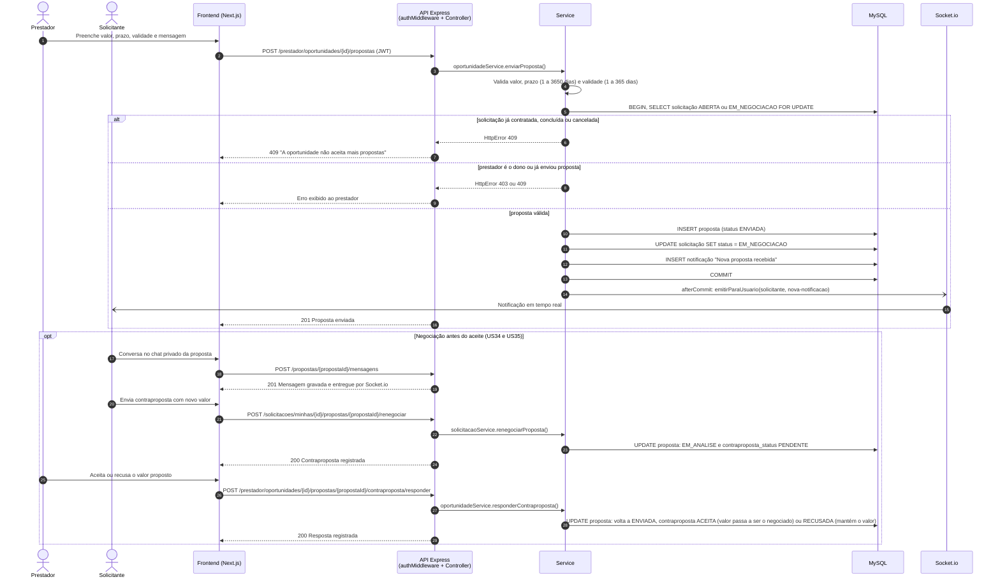
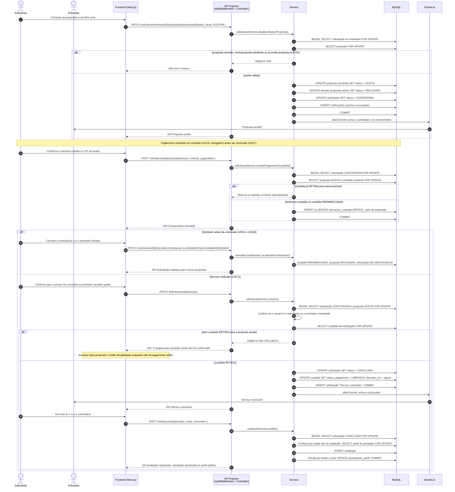

# Diagrama de Sequência — Contratação de um serviço

Gerado em 26/10/2026 a partir do código atual:

- `oportunidadeService.enviarProposta`, `solicitacaoService.renegociarProposta` e `oportunidadeService.responderContraproposta`;
- `solicitacaoService.atualizarStatusProposta`, `simularPagamentoCustodia` e `concluir`;
- `avaliacaoService.avaliar`.

O fluxo vai do envio da proposta até a avaliação do prestador (US10, US12, US13, US17, US18, US34 e US35).

**Como as requisições são processadas:**

- Toda requisição passa pelo `authMiddleware`, que valida o JWT e recusa contas desativadas, e depois pelo controller.
- Cada etapa que altera dados roda numa transação do Sequelize e bloqueia a linha da solicitação com `SELECT ... FOR UPDATE` antes das linhas dependentes. Isso evita condições de corrida, por exemplo dois aceites simultâneos.
- As notificações são gravadas na mesma transação, mas o aviso por Socket.io só é emitido depois do commit (`transaction.afterCommit`). Assim, ninguém é avisado de algo que acabou desfeito.
- As notificações respeitam as preferências de cada usuário (US30).

## 1. Proposta e negociação

## 2. Aceite, pagamento, conclusão e avaliação

## Estados percorridos

| Etapa | Solicitação | Proposta escolhida | Custódia |
|---|---|---|---|
| Publicação | `ABERTA` | — | — |
| Primeira proposta | `EM_NEGOCIACAO` | `ENVIADA` | — |
| Contraproposta | `EM_NEGOCIACAO` | `EM_ANALISE` | — |
| Resposta do prestador | `EM_NEGOCIACAO` | `ENVIADA` (com o valor negociado, se aceito) | — |
| Aceite | `CONTRATADA` | `ACEITA` (as demais ficam `RECUSADA`) | — |
| Pagamento simulado | `CONTRATADA` | `ACEITA` | `RETIDO` |
| Cancelamento ou desistência | `EM_NEGOCIACAO` | `RECUSADA` | `REEMBOLSADO` |
| Conclusão | `CONCLUIDA` | `ACEITA` | `LIBERADO` |

## Regra: pagamento antes da conclusão

Desde 26/10/2026, um critério da US17 (Jira TCC-25) exige que o pagamento simulado esteja retido antes da conclusão. Antes disso, era possível concluir sem pagar, como registrava o `Notas.md`.

- **API:** `solicitacaoService.concluir()` recusa a conclusão com 409 quando a custódia da proposta aceita não está `RETIDO`. Isso vale também quando só existe a custódia já reembolsada de uma contratação anterior.
- **Telas:** em `minhas-solicitacoes/[id]` e `oportunidades/[id]`, o botão de conclusão fica desabilitado até o pagamento ser confirmado, com uma explicação ligada a ele por `aria-describedby`.
- **Prestador:** para mostrar a explicação, o detalhe da oportunidade passou a devolver `pagamento_contratacao`, preenchido só para o prestador contratado.

Por isso, na tabela acima, a etapa de pagamento sempre antecede a conclusão.
